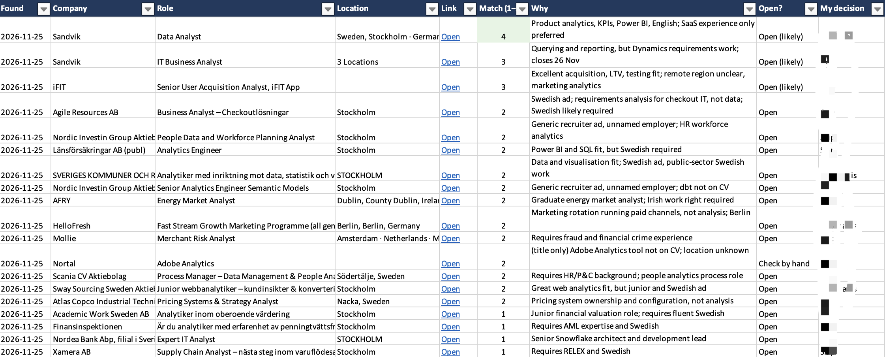
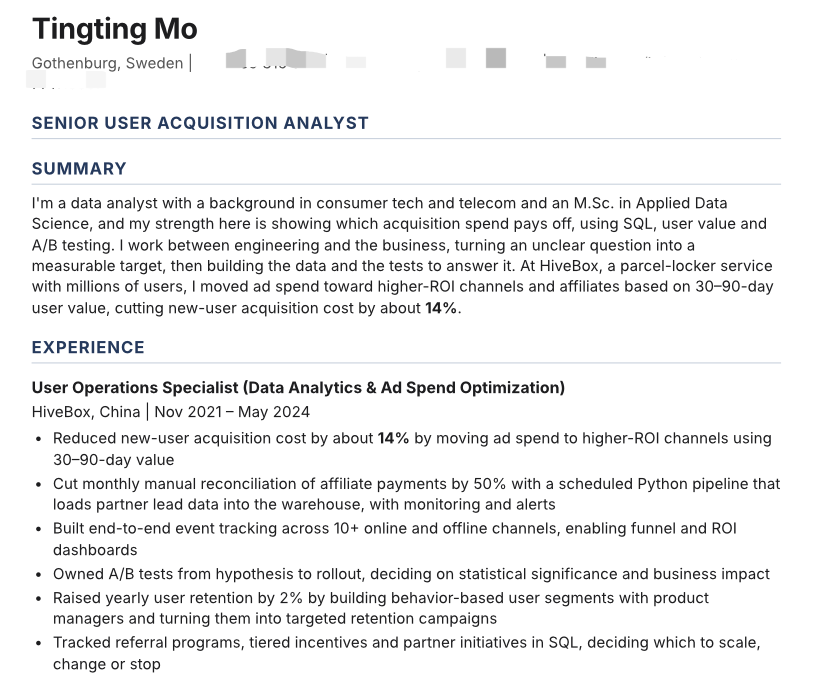
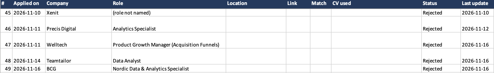

# ting_job_search

**Apply better to fewer jobs.** A small job-search agent that runs in [Claude Code](https://claude.com/claude-code): every morning it finds the jobs that fit you best, writes a tailored CV when you ask, and keeps your applications up to date.

I built it for my own search (data analysis, data operations and marketing/growth analytics in Denmark and Sweden). Everything personal lives in a few plain text files, so you can make it yours.

## Who is this for?

- You're applying to many jobs and want a short, ranked list instead of scrolling job boards.
- You want a CV tailored to each job, but written from your own master CV and in your own voice.
- You want a tracker that updates itself, without a big framework to learn.

The agent never applies for you. You check every job and press "submit" yourself.

## What you get

**A daily shortlist in Excel.** New jobs go to the top, with a 1–5 match score, a one-line reason and a clickable link. You pick *Tailor CV*, *Apply as is* or *Skip* from a dropdown.

**A tailored CV as a PDF**, written from your master CV for one job, only when you ask.

**An application tracker that updates itself.** An optional evening email check finds confirmations, rejections and interview invites.

**A short weekly report** on Wednesday and Saturday: applied, rejected, interviews, still waiting.

## How to use it

Open the folder in Claude Code and just talk to it:

| You say | What happens |
|---|---|
| `start` | Scans job boards and company career pages, scores the new jobs and opens `shortlist.xlsx` |
| `tailor CV for #3` | Writes a CV for row 3 of the shortlist and saves it as a PDF in `cv/` |
| `cover letter for #3` | Same for a cover letter |
| `applied #3` | Adds it to `applications.xlsx` |
| `Klarna invited me to a call` | Updates that application's status and next step |
| `my applications` | A short summary |

Applied, skipped and old jobs move off the shortlist on their own, so it stays short.

## Before you start: prepare your master CV

The agent tailors every CV from one master CV, so **a good master CV matters more than anything else here.** It never invents experience; it only picks and reorders what you give it. Put in everything you might want to show, even if it's longer than a normal CV.

1. **Use a few clear blocks:** a short summary, professional experience, education or research experience, and skills. A link to a portfolio (GitHub, a personal site, a Kaggle profile) helps too.
2. **Give each job 5–6 key stories**: the things you most want a hiring manager to know. The agent chooses the best ones for each job ad.
3. **Write each story with the X-Y-Z rule:** *accomplished X, as measured by Y, by doing Z.* For example: "Cut new-user acquisition cost by about 14% (X, Y) by tracking each user's value over 90 days and moving ad spend to the best channels (Z)."
4. **Add a model cover letter and your writing rules** (`profile/master-cover-letter.md`, `profile/cv-rules.md`), such as how you like to describe yourself and words you never use. A short sample of your own writing helps the agent sound like you.

The templates in `profile/examples/` follow this structure.

## Set it up

1. Install [Node.js](https://nodejs.org) and [Claude Code](https://claude.com/claude-code).
2. Download [Career-Ops](https://github.com/santifer/career-ops) into the folder next to this one and run `npm install` there. This project reuses its job scanner (see *Built on Career-Ops* below).
3. Run `npm install` in this folder.
4. Copy the files in `profile/examples/` into `profile/`, drop `.example` from the names, and fill them in (see *Before you start* above).
5. In `profile/target-positions.md`, list the job titles and locations you want. In `my-sites.md`, switch job boards and company career pages on or off.
6. Open the folder in Claude Code and type `start`.

Want to check the install worked? Run `npm test`. It should end with `pass 8`.

### Optional: evening email check

A scheduled task reads (never sends) your Gmail every evening and updates the tracker. It needs the Gmail connector, the Claude desktop app open and the computer awake. **If you'd rather not give an agent access to your email, skip it:** tell the agent `applied #3` or `X rejected me` yourself, and the tracker works the same.

## How it works

1. **Scan, free:** reads public job feeds and career pages (Greenhouse, Lever, Ashby, Teamtailor, Workday, Platsbanken, The Hub, remote boards and more).
2. **Rank, free:** filters by title and location and keeps the 40 most promising new jobs.
3. **Score, AI:** the agent reads only those 40 job ads and scores each 1–5 on CV match, role direction, location, visa and language.
4. **Shortlist:** the top 20 with a score of 3 or more go into `shortlist.xlsx`.

## Files

| File | What it is |
|---|---|
| `AGENTS.md` | The agent's rules. Change how it works here. |
| `profile/target-positions.md` | Job titles to include and skip, locations in priority order |
| `my-sites.md` | Job boards and company career pages to scan |
| `profile/` | Your master CV, model cover letter and writing rules (kept private) |
| `shortlist.xlsx`, `applications.xlsx` | Your shortlist and tracker |
| `weekly-reports/` | Weekly reports in Markdown (I read them in [Obsidian](https://obsidian.md)) |
| `tools/` | Small Node scripts behind the commands |

## Built on Career-Ops

This project stands on [Career-Ops](https://github.com/santifer/career-ops) by [Santiago Fernández de Valderrama (santifer)](https://github.com/santifer), an open-source AI job-search system for Claude Code (MIT licence). Career-Ops is a much bigger framework: full job evaluations, gap reports, company research and more.

From Career-Ops I reuse the job scanner (reading Greenhouse, Lever, Ashby, Workday, Platsbanken and other job feeds), its title and location filters, and the idea of scoring each job against your CV. On top of that I built a simpler daily routine for myself: a ranked Excel shortlist, tailored CVs only on request, and a tracker that updates from email.

If you want the full system, use Career-Ops directly. Thank you, Santiago, for sharing it.

Built by Tingting Mo with Claude Code.
